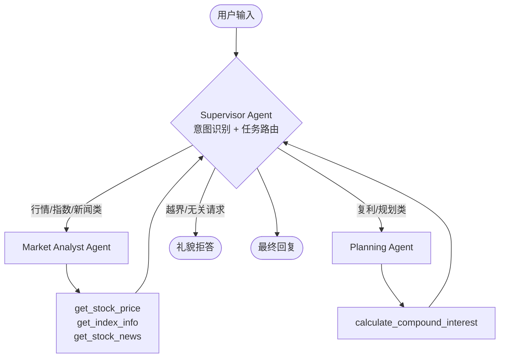

# FinPilot

> 基于 LangGraph 的多 Agent 个人理财助手，支持自然语言交互的行情分析与理财规划。

[](https://www.python.org/) [](https://github.com/langchain-ai/langgraph) [](https://www.deepseek.com/) [](https://claude.ai/chat/LICENSE)[](https://fastapi.tiangolo.com/)
[](https://streamlit.io/)

------

## 项目简介

FinPilot 是一个基于 LangGraph 的多 Agent 系统，针对个人投资者在金融信息查询与理财规划场景下需跨多个工具切换、专业信息门槛高的痛点，搭建了一个支持自然语言交互的智能助手。

系统采用 **Supervisor + 专业子 Agent** 的协作架构：用户输入由 Supervisor Agent 完成意图识别与任务路由，Market Agent 与 Planning Agent 各自基于专属工具集完成行情分析与理财规划。整套系统基于 **ReAct 模式**实现多步推理，支持跨域协作。

> 本项目的设计重点不是工具数量，而是**Agent 协作架构、意图路由准确率、安全边界设计**。所有数据均通过自动化评测验证。

------

## 核心特性

- 🧠 **多 Agent 协作架构**：Supervisor 调度 + 专业子 Agent 各司其职，避免单一 prompt 的"通才化"困境
- 🔁 **ReAct 多步推理**：每个 Agent 在 Reason-Act-Observation 循环中自主决定下一步动作
- 🛡️ **金融场景安全边界**：明确定义能力黑/白名单与投资建议拒答策略,避免越界给出买卖建议
- 📊 **端到端评测体系**：30 条多维度评测集 + 自动化评测脚本，意图路由准确率 93%（28/30）
- 🔌 **工具热插拔扩展**:基于 Tool Schema 抽象，新增 Agent 与工具仅需注册 schema 与映射，主流程零修改
- 🎯 **双模式数据源**：Mock 数据用于快速开发与稳定演示，Tushare 真实数据用于生产场景

------

## 系统架构



### 架构亮点

| 设计                            | 解决的问题                                                   |
| ------------------------------- | ------------------------------------------------------------ |
| Supervisor 模式（而非纯 ReAct） | 金融领域天然需要专业分工：行情查询要求客观陈述，理财规划需要风险提示，单一 system prompt 难以兼顾 |
| 子 Agent 通过 Tool Schema 暴露  | 复用 Function Calling 机制，认知一致；同时让主图保持简洁，子 Agent 内部循环作为黑盒封装 |
| LangGraph StateGraph            | 状态全局可见，流程可视化，循环用边声明而非 for 循环——业务逻辑与流程编排解耦 |
| Conditional Edge 决定流向       | "继续派活"还是"结束并回复"由 Supervisor 自主决策，是真正"自主多步推理"的基础设施 |

------

## 技术栈

- **核心框架**：LangGraph + LangChain
- **LLM**：DeepSeek-V3（兼容 OpenAI 接口）
- **数据源**：Tushare Pro（行情数据）、AKShare（备选）
- **存储**：SQLite（本地持仓 mock）+ 内存缓存
- **评测**：自定义评测脚本 + JSON 评测集

------

## 项目结构

```
finpilot/
├── api/                          # FastAPI 后端
│   ├── main.py                   #   应用入口 + 路由
│   ├── schemas.py                #   Pydantic DTO（请求/响应/SSE 事件）
│   ├── services.py               #   业务逻辑层（封装 LangGraph 调用）
│   └── __init__.py
├── frontend/                     # Streamlit 前端
│   └── app.py                    #   对话界面 + 会话管理
├── tools.py                      # 工具函数（双模式：Mock + Tushare）
├── agents.py                     # 子 Agent（Market / Planning）
├── langgraph_multi_agent.py      # Supervisor + 多 Agent 主图
├── evaluation/
│   ├── test_cases.json           #   30 条评测集
│   ├── run_eval.py               #   评测执行脚本
│   └── eval_results.json         #   评测结果
├── legacy/                       # 早期对比版本（单 Agent / 原生 SDK 等）
├── .env.example                  # 环境变量模板
├── requirements.txt
└── README.md
```

## 快速开始

### 1. 环境准备

```bash
# 创建 conda 环境
conda create -n finpilot python=3.11
conda activate finpilot

# 安装依赖
pip install -r requirements.txt
```

### 2. 配置环境变量

复制 `.env.example` 为 `.env`，填入以下密钥：

```
DEEPSEEK_API_KEY=sk-xxxxxxxxxxxxxxxx
TUSHARE_TOKEN=your_tushare_token
USE_REAL_DATA=false   # 设为 true 切换至真实数据
```

### 3. 运行

````bash
### 3. 启动后端

```bash
uvicorn api.main:app --port 8888
```

启动后访问 http://127.0.0.1:8888/docs 查看自动生成的 API 文档。

### 4. 启动前端（新开终端）

```bash
streamlit run frontend/app.py
```

浏览器自动打开 http://localhost:8501，可以开始多轮对话。

### 5. 跑评测（可选）

```bash
python evaluation/run_eval.py
```
````

------

## 评测体系

### 评测集设计

构建 30 条评测集，覆盖 9 类场景：

| 类别                | 数量  | 说明                               |
| ------------------- | ----- | ---------------------------------- |
| 单 Agent - 行情查询 | 2     | 基础路由                           |
| 单 Agent - 指数查询 | 2     | 不同工具选择                       |
| 单 Agent - 新闻查询 | 1     | 新闻类工具                         |
| 单 Agent - 多工具   | 1     | 单 Agent 内多工具协作              |
| 单 Agent - 理财计算 | 3     | Planning Agent 不同表述            |
| 多 Agent - 显式跨域 | 3     | 用户明确说明分步任务               |
| 多 Agent - 隐式跨域 | 2     | 跨域意图未显式表达                 |
| 边界场景            | 6     | 模糊问题、口语化、参数不全等       |
| **对抗性 query**    | **5** | **越界请求、能力边界、投资建议等** |

### 评测过程：误差分析驱动的迭代优化

**Round 1（初版 Supervisor prompt）**

- 准确率：**90% (27/30)**
- 失败模式分析：
  - 越界请求未拒答（如 "帮我下单买茅台"）
  - 能力边界外的请求被强行处理（如 "我去年买的茅台现在赚了多少"）
  - 主观投资建议未做安全处理（如 "茅台现在 1450 该买还是卖"）
- 失败模式归类：**Supervisor prompt 只定义了"能力内"的行为，缺少"能力外"的拒答策略**

**Round 2（升级 prompt 后）**

针对性升级 Supervisor prompt：

1. 加入**能力黑/白名单**：明确说明系统不支持交易下单、历史持仓、汇率换算等场景
2. 加入**投资建议安全边界**：对买卖决策类问题只陈述事实，不直接给建议
3. 加入**数据局限说明**：涉及不确定数据时明确说明来源

- 准确率：**93% (28/30)**
- ✅ 修复了 Round 1 的全部 3 条失败
- ❗ **引入 2 条 regression**:隐式跨域请求（如"我想配置点新能源板块"）被新规则误伤为单 Agent 处理

### 关键发现：Prompt 规则的过度泛化

Round 2 的 regression 揭示了一个工程问题：**prompt 规则会过度泛化**。

新加的"投资建议时不调用 Planning Agent"规则，本意是防止越界给买卖建议，但 LLM 把它泛化到了所有"配置/规划"类请求上，把真正需要 Planning 的场景也误伤了。

**这一发现的工程意义**：

- 评测集的核心价值不是"输出准确率"，而是**自动检测 regression**
- prompt-only 的路由设计存在天然天花板，规则越严越易误伤
- 未来更优方案可能是 LangGraph 的 conditional edges 做精细路由，或用小模型做 query 分类预过滤

> 这次评测的最大收获不是 28/30 这个数字，而是**完整经历了"评测发现问题 → 误差分析 → 优化 → 复测 → 发现 regression → 沉淀工程认知"的完整循环**。

## 前后端架构

项目采用前后端分离设计，业务逻辑与 UI 解耦：

### 后端：FastAPI

- **`POST /chat`** —— 同步对话接口，返回完整 JSON
- **`POST /chat/stream`** —— SSE 流式接口，推送 `agent_routing`、`agent_completed`、`final_reply`、`done` 等事件
- **`GET /health`** —— 健康检查（cloud-native 部署规范）
- **自动文档**：访问 `/docs` 查看 Swagger 自动生成的 API 文档
- **分层设计**：`schemas.py`（DTO） → `services.py`（业务） → `main.py`（路由），职责清晰

### 前端：Streamlit

- 基于 `st.chat_message` + `st.chat_input` 实现聊天 UI
- 用 `st.session_state` 维护对话历史，跨脚本重跑保留状态
- 通过 `requests.post` 调用后端，错误处理 + 加载动画 + 元信息展示
- 侧边栏支持"清空对话"等操作

### 多轮对话实现

LLM 本身是无状态的——多轮对话靠每次传完整历史实现：

1. **前端**：`session_state.messages` 维护对话历史
2. **请求时**：把 `history`（不含当前消息）作为独立字段发给后端
3. **后端适配器**：`_build_messages()` 把前端 dict 格式转换为 LangChain `HumanMessage`/`AIMessage` 对象
4. **未来升级路径**：`history` 字段可平滑升级为 `session_id` + 服务端会话管理（Redis）

---

## 工程实践细节

这一节记录项目中遇到的真实工程问题与解决方案——这些细节体现了从 "Demo 项目" 到 "生产级项目" 的差异。

### 1. 数据源限流与降级策略

**问题**：Tushare 免费版的 `stock_basic` 接口限频为 1 次/小时，每次查询股票名都调用会立即触发限流。

**方案**：
- 设计双模式架构：通过环境变量 `USE_REAL_DATA` 切换 Mock / 真实数据
- Mock 模式作为开发期主力 + 演示兜底，避免外部 API 不稳定影响 Demo
- 真实数据模式预留启动时预加载 + 内存缓存的扩展点

### 2. CORS 与 SSE 反向代理

**问题**：Nginx 等反向代理默认对 SSE 响应做缓冲，会导致流式被压成"一次性返回"。

**方案**：在 SSE 响应头加入 `X-Accel-Buffering: no` 明确禁用 Nginx 缓冲；同时配置 `CORSMiddleware` 为前端跨域访问预留能力。

### 3. 客户端会话管理

**问题**：LLM 是无状态的，多轮对话需要每次传完整历史。

**方案**：
- 前端 Streamlit 用 `session_state` 维护对话历史
- 请求时把 `history`（不含当前消息）作为独立字段发给后端
- 后端 `_build_messages()` 适配器把前端 dict 格式转换为 LangChain Message 对象
- 设计上预留了向服务端会话管理（Redis）平滑升级的接口